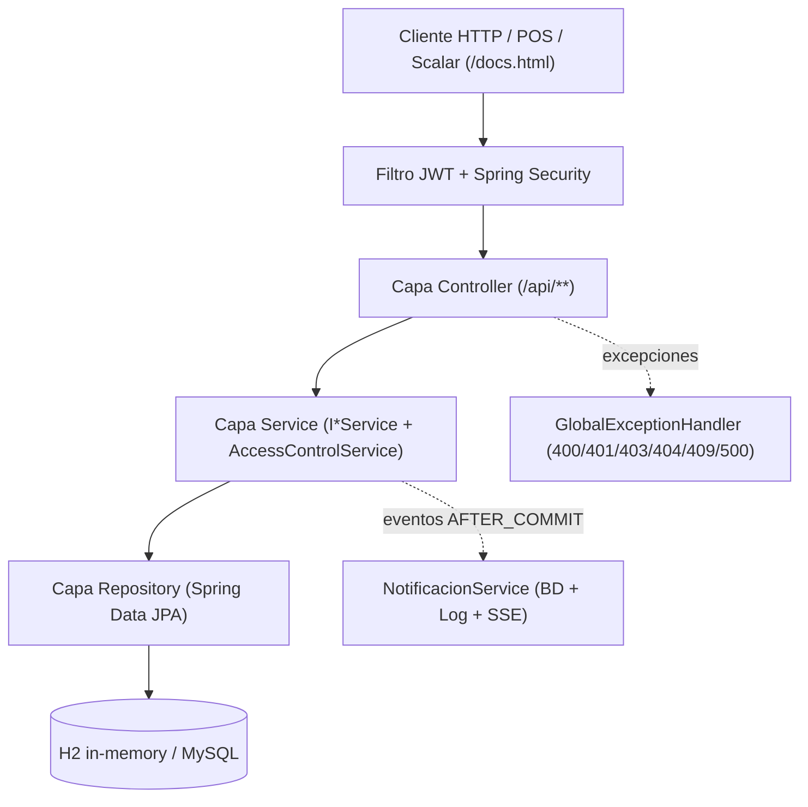

# StockCommerce API (`stockapihb`)

API REST para la **gestión integral de inventario multi-sucursal y multi-depósito**, desarrollada con **Java 17** y **Spring Boot 4**. Incluye control de acceso basado en roles y ubicaciones (**RBAC + JWT**), trazabilidad de movimientos, reservas por apartados, órdenes de compra a proveedores, transferencias con flujo de aprobación, alertas automáticas de stock bajo en tiempo real (**SSE**) y reportes operativos y financieros.

---

## Stack tecnológico

| Tecnología | Versión / Detalle |
|---|---|
| **Lenguaje** | Java 17 + Lombok |
| **Framework** | Spring Boot `4.0.5` (`webmvc`, `data-jpa`, `validation`, `security`) |
| **Seguridad** | Spring Security + JWT (`HMAC-SHA256`, expiración configurable) |
| **Persistencia** | Hibernate / JPA sobre **H2 en memoria** (`MODE=MySQL`) — driver MySQL incluido |
| **Documentación API** | `springdoc-openapi` `3.1.1` + interfaz interactiva **Scalar** (`/docs.html`) |
| **Testing** | JUnit 5 + Spring Boot Test (`17` tests de integración) |
| **Build** | Maven Wrapper (`mvnw.cmd` / `./mvnw`) |

---

## Arquitectura del proyecto

El sistema sigue una **arquitectura multicapa** con separación estricta entre controladores REST, lógica de negocio (interfaces + implementaciones), acceso a datos, seguridad por alcance y eventos de dominio:



### Estructura de paquetes

```text
src/main/java/com/stockcomerce/stockapihb
├── StockapihbApplication.java     # Punto de entrada
├── controller/                    # 15 RestControllers (API REST)
├── services/                      # Interfaces I*Service e implementaciones transaccionales
├── repositories/                  # 14 interfaces JpaRepository con consultas JPQL
├── models/                        # Entidades JPA y enums de estado/ubicación
├── dto/                           # DTOs de entrada/salida con Bean Validation (@Valid)
├── mapper/                        # Mapper estático Entity -> DTO (con control de visibilidad de costos)
├── security/                      # JWT, filtros, roles (RolCodigo), permisos (Permiso) y AccessControlService
├── events/                        # StockBajoEvent (publicado al cruzar el umbral mínimo)
└── exception/                     # GlobalExceptionHandler, NotFoundException, ConflictException, ForbiddenException
```

---

## Modelo de negocio y flujos clave

### 1. Inventario por ubicación (`TIENDA` / `DEPOSITO`)
- El stock no pertenece al producto globalmente, sino a cada par único `(Producto, Ubicación)`.
- Cada registro de `Inventario` controla:
  - `cantidad`: unidades físicas presentes en la ubicación.
  - `cantidadReservada`: unidades bloqueadas por apartados activos.
  - `cantidadDisponible`: `max(0, cantidad - cantidadReservada)`.
  - `stockMinimo`: umbral de alerta (por defecto **`12`** en `application.properties`, configurable por fila).

### 2. Alertas automáticas de stock bajo (`< 12`)
- Al descontar stock (por venta, transferencia, salida manual o ajuste de conteo), si el inventario **cruza hacia abajo** el `stockMinimo` (`anterior >= minimo && nueva < minimo`), se publica `StockBajoEvent`.
- `NotificacionService` procesa el evento **solo tras el `COMMIT`** (`@TransactionalEventListener(AFTER_COMMIT)`), evitando alertas falsas en caso de *rollback*.
- La alerta se persiste en `Notificacion`, se registra en log (`WARN`) y se transmite en vivo por **Server-Sent Events** (`GET /api/notificaciones/stream`). No se duplica mientras el stock siga debajo del mínimo; vuelve a dispararse si se repone y cae nuevamente.

### 3. Máquinas de estado implementadas
- **Órdenes de Compra (`EstadoOrdenCompra`):** `PENDIENTE_APROBACION` → `APROBADA` → `RECIBIDA_PARCIAL` → `RECIBIDA_COMPLETA` (o `CANCELADA`). Cada recepción genera automáticamente entradas de stock.
- **Transferencias (`EstadoTransferencia`):** `SOLICITADA` → `APROBADA` → `EN_TRANSITO` *(descuenta en origen)* → `COMPLETADA` *(incrementa en destino)*, o `RECHAZADA`. También admite transferencia directa para perfiles con permiso global.
- **Apartados (`EstadoApartado`):** `ACTIVO` *(reserva stock)* → `COMPLETADO` *(libera reserva y genera Venta + Salida)* o `CANCELADO` *(libera reserva)*.

### 4. Integridad y precisión financiera
- Todos los importes (`precio`, `costo`, `subtotal`, `total`, `montoAbonado`) usan `BigDecimal`.
- Al crear una venta, el precio se obtiene del catálogo (ignorando valores manipulados por el cliente). Si algún ítem no tiene stock disponible, la transacción completa hace **rollback**.
- Eliminar una venta revierte el stock; eliminar un producto o tienda con movimientos devuelve **`409 Conflict`**.

---

## Seguridad: JWT y RBAC por alcance

Todas las rutas `/api/**` requieren token Bearer JWT (excepto `POST /api/auth/login`, `/docs.html`, `/v3/api-docs/**` y `/h2-console/**`).

| Rol (`RolCodigo`) | Nivel de riesgo | Alcance (`TipoAlcance`) | Ubicación admitida | Capacidades principales |
|---|---|---|---|---|
| **`ADMIN`** | Crítico | `GLOBAL` | Todas | Control total: catálogo/precios, usuarios, roles, sucursales, operaciones y reporte financiero consolidado. |
| **`SUPERVISOR_COMPRAS`** | Alto | `GLOBAL` | Todas | Visión consolidada y por proveedor, costos, configuración de stock mínimo, aprobación de órdenes de compra y transferencias, reportes de rotación y márgenes. |
| **`ENCARGADO_DEPOSITO`** | Medio | `UBICACION` | Solo `DEPOSITO` | Entradas, salidas manuales, envío/recepción de transferencias, ajustes por conteo físico y reportes operativos en sus depósitos asignados. |
| **`CAJERO_VENDEDOR`** | Operativo | `UBICACION` | Solo `TIENDA` | Cobros en POS, consulta de disponibilidad (**sin ver costos**) y gestión de apartados exclusivamente en su tienda asignada. |

> **Credenciales iniciales de desarrollo** (configurables en `src/main/resources/application.properties`):
> - **Usuario:** `admin`
> - **Contraseña:** `admin123`

---

## Endpoints principales

| Módulo | Rutas base | Operaciones clave |
|---|---|---|
| **Autenticación** | `/api/auth` | `POST /login`, `GET /me` |
| **Usuarios y Roles** | `/api/usuarios`, `/api/roles` | Listar roles, crear usuarios, editar asignaciones de rol/ubicación, activar/desactivar |
| **Productos** | `/api/productos` | `GET`, `POST`, `PUT /{id}`, `DELETE /{id}` |
| **Proveedores** | `/api/proveedores` | `GET`, `POST`, `PUT /{id}`, `DELETE /{id}` |
| **Ubicaciones** | `/api/tiendas` *(alias `/api/tienda`)* | `GET`, `GET /catalogo`, `POST`, `PUT /{id}`, `DELETE /{id}` |
| **Inventario** | `/api/inventario` | `GET`, `/consolidado`, `/proveedor/{id}`, `/tienda/{id}`, `/producto/{id}`, `/stock`, `PUT /stock-minimo` |
| **Entradas / Salidas** | `/api/entradas`, `/api/salidas` | Registrar ingresos, salidas manuales y consultar salidas por venta |
| **Ajustes por Conteo** | `/api/ajustes-conteo` | Listar y registrar conteo físico de inventario |
| **Órdenes de Compra** | `/api/ordenes-compra` | Crear, `PUT /{id}/aprobar`, `PUT /{id}/cancelar`, `POST /{id}/recepcion` |
| **Transferencias** | `/api/transferencias` | Directa (`POST`), o flujo `/solicitar`, `/{id}/aprobar`, `/{id}/rechazar`, `/{id}/enviar`, `/{id}/recibir` |
| **Ventas** | `/api/ventas` | `GET`, `POST`, `PUT /{id}`, `DELETE /{id}` (revierte stock) |
| **Apartados** | `/api/apartados` | `GET`, `POST`, `POST /{id}/cobrar`, `PUT /{id}/cancelar` |
| **Notificaciones** | `/api/notificaciones` | `GET` (`?soloNoLeidas=true`), `GET /stream` (SSE), `PUT /{id}/leida`, `PUT /leidas` |
| **Reportes** | `/api/reportes` | `/stock-bajo`, `/resumen-tiendas`, `/movimientos` (`page`/`size`), `/margenes`, `/rotacion`, `/cumplimiento-recepcion`, `/financiero-consolidado` |

### Formato estándar de errores (`GlobalExceptionHandler`)

Todas las excepciones de negocio devuelven JSON uniforme `{ "timestamp", "status", "error", "message" }`:
- `400 Bad Request`: validaciones `@Valid`, stock insuficiente, transiciones de estado inválidas o JSON malformado.
- `401 Unauthorized`: credenciales inválidas, usuario inactivo o token ausente/expirado.
- `403 Forbidden`: permiso insuficiente o intento de operar fuera de la ubicación asignada.
- `404 Not Found`: entidad no encontrada.
- `409 Conflict`: eliminación de registro en uso o violación de integridad.
- `500 Internal Server Error`: error interno no controlado.

---

## Puesta en marcha local

### Requisitos
- **JDK 17** instalado y configurado en `JAVA_HOME`.

### 1. Ejecutar la suite de tests
```powershell
# Windows (PowerShell)
.\mvnw.cmd test

# Linux / macOS
./mvnw test
```
Ejecuta las pruebas de contexto, flujo de stock/notificaciones (`StockFlowIntegrationTest`) y control de acceso por rol y alcance (`RbacAlcanceIntegrationTest`).

### 2. Levantar la aplicación
```powershell
# Windows (PowerShell)
.\mvnw.cmd spring-boot:run

# Puerto alternativo (si 8080 está ocupado)
.\mvnw.cmd spring-boot:run "-Dspring-boot.run.arguments=--server.port=8081"
```

### 3. Accesos útiles en ejecución
- **Documentación interactiva (Scalar):** `http://localhost:8080/docs.html`
- **Esquema OpenAPI (JSON):** `http://localhost:8080/v3/api-docs`
- **Consola H2:** `http://localhost:8080/h2-console` *(JDBC URL: `jdbc:h2:mem:midb`, Usuario: `sa`, Contraseña vacía)*

### Ejemplo rápido (Login + consulta)
```bash
# 1. Obtener token JWT
curl -X POST http://localhost:8080/api/auth/login \
  -H "Content-Type: application/json" \
  -d '{"username":"admin","password":"admin123"}'

# 2. Consultar perfil autenticado
curl http://localhost:8080/api/auth/me \
  -H "Authorization: Bearer <TOKEN_JWT>"
```
