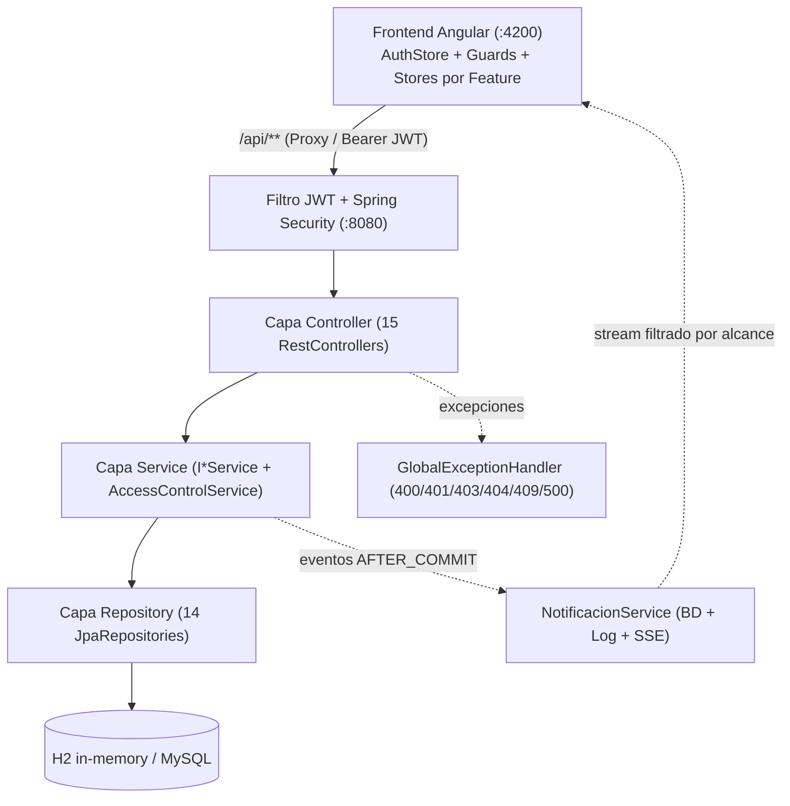

# StockCommerce — Plataforma Multi-Sucursal de Inventario, POS y Compras

Monorepo integral para la **gestión de inventario multi-sucursal y multi-depósito**, punto de venta (**POS**), abastecimiento a proveedores y control de acceso basado en **riesgo, responsabilidad y alcance de datos (RBAC + JWT)**.

Integra un backend **Spring Boot 4 (Java 17)** y un frontend **Angular 20 (Standalone + Signals + PrimeNG Aura + Tailwind CSS v4)** bajo una misma raíz lista para ejecutar en desarrollo con un solo comando.

---

## Estructura del monorepo

```text
stockcomerce/
├── backend/                   # API REST Spring Boot 4 + JPA + Spring Security JWT
│   ├── pom.xml
│   ├── mvnw / mvnw.cmd
│   └── src/
├── frontend/                  # SPA Angular 20 + PrimeNG + Tailwind CSS
│   ├── package.json
│   ├── angular.json
│   ├── proxy.conf.json        # Proxy dev /api -> http://localhost:8080
│   └── src/
├── dev.ps1                    # Lanzador unificado (Backend :8080 + Frontend :4200)
├── .gitignore                 # Reglas conjuntas para Java/Maven y Node/Angular
└── README.md
```

---

## Stack tecnológico

### Backend (`backend/`)
| Tecnología | Versión / Detalle |
|---|---|
| **Lenguaje** | Java 17 + Lombok |
| **Framework** | Spring Boot `4.0.5` (`webmvc`, `data-jpa`, `validation`, `security`) |
| **Seguridad** | Spring Security + JWT (`HMAC-SHA256`, expiración configurable) |
| **Persistencia** | Hibernate / JPA sobre **H2 en memoria** (`MODE=MySQL`) — driver MySQL incluido |
| **Documentación API** | `springdoc-openapi` `3.1.1` + interfaz interactiva **Scalar** (`/docs.html`) |
| **Testing** | JUnit 5 + Spring Boot Test (`17` tests de integración) |

### Frontend (`frontend/`)
| Tecnología | Versión / Detalle |
|---|---|
| **Framework** | Angular `20.3` (Standalone Components, Zoneless Change Detection, Signals) |
| **UI & Estilos** | PrimeNG `20.4` (`Aura` theme con modo oscuro `.p-dark`) + PrimeIcons + Tailwind CSS `4.3` |
| **Comunicación** | `HttpClient` con interceptores funcionales (`authInterceptor`, `errorInterceptor`) + `EventSource` (SSE) |
| **Seguridad UI** | `AuthStore`, `authGuard`, `guestGuard`, `permisoGuard` y navegación dinámica por capacidad |

---

## Arquitectura del sistema



### Paquetes del Backend (`backend/src/main/java/com/stockcomerce/stockapihb`)
- `controller/`: 15 controladores REST (`/api/auth`, `/api/usuarios`, `/api/roles`, `/api/productos`, `/api/proveedores`, `/api/tiendas`, `/api/inventario`, `/api/entradas`, `/api/salidas`, `/api/ajustes-conteo`, `/api/ordenes-compra`, `/api/transferencias`, `/api/ventas`, `/api/apartados`, `/api/notificaciones`, `/api/reportes`).
- `services/`: interfaces `I*Service` e implementaciones transaccionales.
- `repositories/`: 14 repositorios JPA con consultas JPQL optimizadas.
- `models/`: entidades JPA y enums (`TipoUbicacion`, `EstadoOrdenCompra`, `EstadoTransferencia`, `EstadoApartado`).
- `dto/` & `mapper/`: DTOs con Bean Validation (`@Valid`) y `Mapper` con ocultamiento automático de costos según permisos.
- `security/`: `JwtService`, `JwtAuthenticationFilter`, `SecurityConfig`, `RolCodigo`, `Permiso`, `NivelRiesgo`, `TipoAlcance`, `AccessControlService` y `DataInitializer`.
- `events/` & `exception/`: `StockBajoEvent` y `GlobalExceptionHandler`.

### Módulos del Frontend (`frontend/src/app`)
- `core/`: `AuthStore`, `AuthService`, `authInterceptor`, `errorInterceptor`, `authGuard`/`permisoGuard` y `TiendaSeleccionadaStore`.
- `layout/shell/`: barra lateral dinámica por capacidades, selector global/contextual de ubicación, diálogo **"Mi alcance"** y bandeja de alertas SSE en tiempo real.
- `features/auth/`: pantalla de inicio de sesión (`/login`) con acceso rápido al usuario administrador inicial.
- `features/resumen/`: tablero operativo (`/resumen`) con KPIs y alertas adaptados a permisos (sin exponer costos a roles operativos).
- `features/pos/`: terminal POS (`/pos`), cobro por caja asignada, disponibilidad neta en tienda y ciclo completo de **apartados** (reserva, cobro, cancelación).
- `features/inventario/`: existencias por ubicación, vista **Consolidado / Por Proveedor** (para Compras/Admin) y **Ajustes por Conteo Físico** (`/inventario`).
- `features/movimientos/`: registro de entradas, salidas operativas (`MERMA`, `ROTURA`, `CONSUMO_INTERNO`, `DESPACHO_EXTERNO`), bandeja de **transferencias** (`Solicitar → Aprobar → Despachar → Recibir`) e historial auditado (`/movimientos`).
- `features/compras/`: gestión de proveedores, emisión/aprobación de **órdenes de compra** y recepción física parcial o total (`/compras`).
- `features/productos/` & `features/tiendas/`: catálogo con costos y márgenes protegidos (`/productos`), y administración de `TIENDA` vs `DEPOSITO` (`/tiendas`).
- `features/reportes/`: analítica de **Márgenes**, **Rotación**, **Cumplimiento de Recepción** y **Financiero Consolidado** (`/reportes`).
- `features/usuarios/`: matriz visual de roles por riesgo y editor multi-vínculo `Usuario + Rol + Ubicación (+ Caja)` (`/usuarios`).

---

## Seguridad: RBAC por riesgo, responsabilidad y alcance

Cada usuario se vincula contextualmente mediante `AsignacionRol` (`Usuario + Rol + Ubicación + Caja opcional`). Un mismo usuario puede operar en múltiples sucursales o depósitos, e incluso desempeñar roles distintos en cada ubicación.

| Rol (`RolCodigo`) | Riesgo | Alcance (`TipoAlcance`) | Ubicación admitida | Capacidades y restricciones clave |
|---|---|---|---|---|
| **`ADMIN`** | Crítico | `GLOBAL` | Todas | Control total: catálogo, precios/costos, usuarios, roles, sucursales, operaciones y reporte financiero consolidado. |
| **`SUPERVISOR_COMPRAS`** | Alto | `GLOBAL` | Todas | Inventario consolidado y por proveedor, costos, stock mínimo, proveedores, aprobación de OC y transferencias, reportes de rotación, márgenes y cumplimiento de recepción. **No opera caja/POS ni ve el financiero consolidado.** |
| **`ENCARGADO_DEPOSITO`** | Medio | `UBICACION` | Solo `DEPOSITO` | Catálogo (sin costos), entradas, salidas operativas, conteos físicos y envío/recepción en sus depósitos asignados. **No modifica precios ni crea usuarios.** |
| **`CAJERO_VENDEDOR`** | Operativo | `UBICACION` | Solo `TIENDA` | Cobro POS en su caja/sucursal, consulta de stock disponible **sin costos** y gestión de apartados. **Sin reportes consolidados ni configuración.** |

> **Credenciales iniciales de desarrollo** (configurables en `backend/src/main/resources/application.properties`):
> - **Usuario:** `admin`
> - **Contraseña:** `admin123`

---

## Modelo de negocio y máquinas de estado

- **Inventario por `(Producto, Ubicación)`:** controla `cantidad` física, `cantidadReservada` (por apartados activos) y `cantidadDisponible` (`max(0, cantidad - cantidadReservada)`).
- **Alertas automáticas de stock bajo (`< 12` por defecto):** al cruzar el umbral hacia abajo tras un `COMMIT` (`@TransactionalEventListener(AFTER_COMMIT)`), se persiste la alerta y se transmite por **SSE** (`/api/notificaciones/stream?token=...`) únicamente a los usuarios cuyo alcance incluya esa ubicación.
- **Órdenes de Compra:** `PENDIENTE_APROBACION` → `APROBADA` → `RECIBIDA_PARCIAL` → `RECIBIDA_COMPLETA` (o `CANCELADA`).
- **Transferencias:** `SOLICITADA` → `APROBADA` → `EN_TRANSITO` *(descuenta en origen)* → `COMPLETADA` *(incrementa en destino)*, o `RECHAZADA`.
- **Apartados:** `ACTIVO` *(reserva stock)* → `COMPLETADO` *(libera reserva y genera Venta + Salida)* o `CANCELADO` *(libera reserva)*.
- **Precisión financiera:** todos los importes usan `BigDecimal`, el precio de venta se toma del catálogo en el servidor y las operaciones fallidas ejecutan **rollback** atómico.

---

## Puesta en marcha local

### Requisitos previos
- **JDK 17** (para el backend)
- **Node.js 20+ / npm** (para el frontend)

### Opción rápida: levantar todo con `dev.ps1` (Windows)
Desde la raíz `stockcomerce/`:
```powershell
.\dev.ps1
```
El script detecta `JAVA_HOME` (JDK 17), instala `frontend/node_modules/` si hiciera falta, inicia el backend en `:8080` y el frontend en `:4200`, y detiene ambos limpiamente al presionar `Ctrl+C`.

*(Si PowerShell bloquea scripts locales la primera vez, ejecutá `Set-ExecutionPolicy -Scope CurrentUser RemoteSigned`.)*

### Ejecución manual por separado

#### Backend
```powershell
cd backend
.\mvnw.cmd test              # Ejecuta los 17 tests de integración
.\mvnw.cmd spring-boot:run   # Inicia la API en http://localhost:8080
```

#### Frontend
```powershell
cd frontend
npm install                  # Solo la primera vez
npm start                    # Inicia Angular en http://localhost:4200 con proxy a :8080
npm run build                # Compila bundle de produccion en frontend/dist/
```

---

## Accesos útiles en ejecución

- **Aplicación Web (Angular):** `http://localhost:4200`
- **Documentación interactiva API (Scalar):** `http://localhost:8080/docs.html`
- **Esquema OpenAPI (JSON):** `http://localhost:8080/v3/api-docs`
- **Consola H2:** `http://localhost:8080/h2-console` *(JDBC URL: `jdbc:h2:mem:midb`, Usuario: `sa`, Contraseña vacía)*

### Ejemplo rápido por consola (`curl`)
```bash
# 1. Autenticarse y obtener token JWT
curl -X POST http://localhost:8080/api/auth/login \
  -H "Content-Type: application/json" \
  -d '{"username":"admin","password":"admin123"}'

# 2. Consultar perfil y permisos efectivos
curl http://localhost:8080/api/auth/me \
  -H "Authorization: Bearer <TOKEN_JWT>"
```
